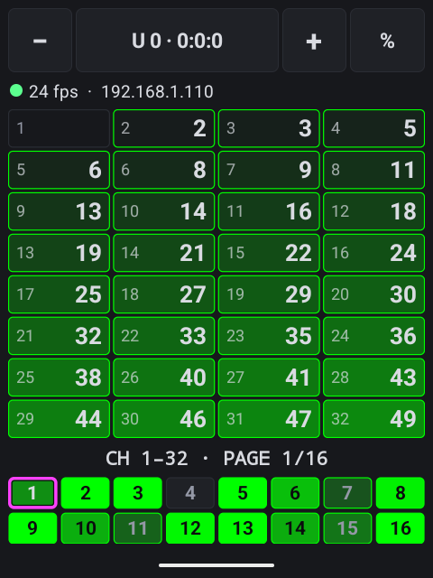
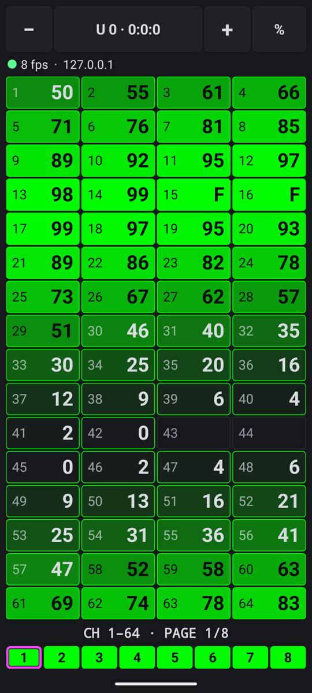
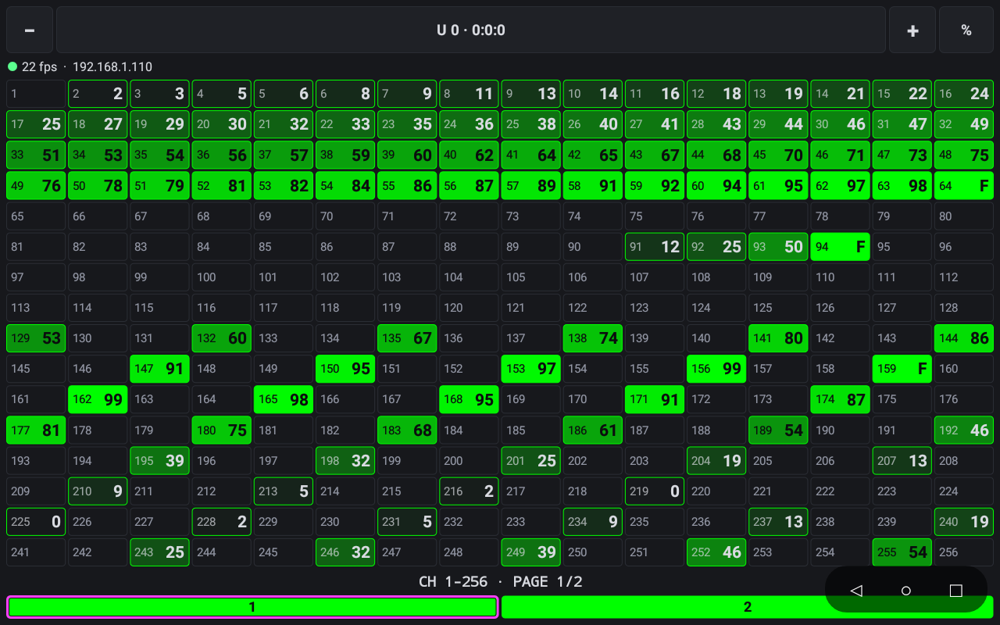

# Pocket Art-Net

Art-Net DMX monitor for small Android screens, built for the Rabbit R1 (CipherOS) and sideloaded with
adb. It runs on Android 5.1 (API 22) and later, phones and tablets included. Colors follow the DMX tab
of consolelink.

- The grid adapts to the screen: it shows as many channels per page as it can while keeping each cell
  readable (at least 56 x 32 dp), choosing from 32x16 (a whole universe), 16x32, 16x16, 16x8, 8x16,
  8x8, 4x16 and 4x8. Wide cells show the channel number and level side by side; squarer cells stack them.
- The page bar shows the highest level on each page so you can see where activity is (up to 8 tabs per
  row; hidden when the whole universe fits on one page). Changing layout keeps the same first channel.
- The app follows the device's natural orientation (portrait on the R1 and phones, landscape on the frame).
- Universe: `−` / `+`, or tap the universe chip for a list of active universes (with fps and source IP)
  or to type one (`12` or `net:sub:uni`, e.g. `0:0:12`). Universes are Art-Net port addresses (0-based).
- Values: tap the mode chip to cycle `%` (F = full) / `255` / `HEX`. Zero is blank, as in consolelink.
- Tap a cell for a live readout of that channel; tap the readout line to clear it.
- Pages: swipe left/right, tap or drag along the page bar, or use the scroll wheel (it sends volume keys).
- No data for 2.5 s: the grid dims and holds the last look, and the status line counts the time.
- Answers ArtPoll, so consoles that only send to discovered nodes find it as "Pocket Art-Net" with one output
  on the selected universe.

## Tested devices

| Device | Android | Screen | Grid |
|---|---|---|---|
| Rabbit R1 (CipherOS) | 16 (API 36) | 480x640 portrait, density 190 | 4x8, 16 pages |
| Phone emulator (Medium Phone) | 17 (API 37) | 1080x2400 portrait, density 420 | 4x16, 8 pages |
| Rockchip rk312x photo frame | 5.1 (API 22) | 1280x800 landscape, density 160 | 16x16, 2 pages |

The layout choice is `GridShape.choose()` in `Format.kt`; unit tests pin these three cases.

<table>
  <tr>
    <td align="center"><br>Rabbit R1 (4x8)</td>
    <td align="center"><br>Phone emulator (4x16)</td>
  </tr>
  <tr>
    <td colspan="2" align="center"><br>Photo frame (16x16)</td>
  </tr>
</table>

On the photo frame, the floating ◁ ○ □ buttons come from its launcher, not from this app. The phone
emulator receives packets sent from inside itself (127.0.0.1), hence the low frame rate.

## Build and install

```sh
./gradlew assembleDebug                      # add --offline when the Gradle cache is warm
adb install -r app/build/outputs/apk/debug/app-debug.apk
adb shell am start -n com.gaeljaffrain.pocketartnet/.MainActivity
```

## Unit tests

```sh
./gradlew testDebugUnitTest
```

JVM tests (no device needed) cover universe parsing/labels, value formatting, the grid layout choice,
ArtDmx decoding, the ArtPollReply layout, and a loopback UDP round trip. GitHub Actions runs them, plus a debug
build, on every push to `main` and every pull request (`.github/workflows/test.yml`).

## Test without a console

```sh
python3 tools/artnet_test_sender.py                       # broadcast universes 0 and 1
python3 tools/artnet_test_sender.py --ip <R1-IP> -u 0 3   # unicast
```

The idle status line shows the device's IP. The API 37 emulator does not receive host UDP via
`adb emu redir`; inject packets from inside it instead (plain `nc -u` waits forever, so kill it):

```sh
adb push artdmx.bin /data/local/tmp/       # an ArtDmx packet saved to a file
adb shell 'for i in $(seq 1 100); do nc -u 127.0.0.1 6454 < /data/local/tmp/artdmx.bin & p=$!; sleep 0.1; kill $p; done'
```

## R1 hardware keys

The scroll wheel sends volume up/down keys, which change page. The side button is the power key: Android
handles it (sleep/lock) and apps can't remap it. Unmapped keys are logged; to see what other hardware sends:

```sh
adb logcat -s PocketArtNet
```
